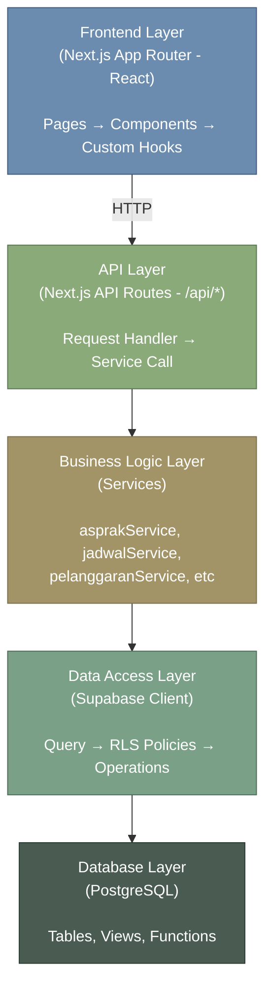

# Sistem Manajemen Asprak - Technical Documentation

⚠️ **PROPRIETARY SOFTWARE** - This software is proprietary and confidential. Unauthorized use, copying, modification, or distribution is strictly prohibited. See [LICENSE](./LICENSE) for details.

---

## Documentation Overview

This documentation provides comprehensive technical information about the **Sistem Manajemen Asprak (Teaching Assistant Management System)** - a web-based application for managing teaching assistants, scheduling, violation tracking, and administrative operations in an informatics laboratory.

## Quick Links

### For Developers

- **[Architecture Document](./docs/ARCHITECTURE.md)** - System design, components, and data flow
- **[API Reference](./docs/API_REFERENCE.md)** - Complete API documentation with endpoint specifications
- **[Development Guide](./docs/DEVELOPMENT.md)** - Setup, running, testing, and debugging
- **[Services Documentation](./docs/SERVICES.md)** - Business logic and service layer explanation
- **[Database Schema](./docs/DATABASE.md)** - Database structure, tables, and relationships

### For Operations/DevOps

- **[Deployment Guide](./docs/DEPLOYMENT.md)** - Deployment procedures, configuration, and monitoring
- **[Security & RBAC](./docs/SECURITY.md)** - Authentication, authorization, and security considerations
- **[Troubleshooting Guide](./docs/TROUBLESHOOTING.md)** - Common issues and solutions
- **[Changelog](./docs/CHANGELOG.md)** - Version history and releases

---

## Table of Contents

1. [Project Overview](#project-overview)
2. [Technology Stack](#technology-stack)
3. [Key Features](#key-features)
4. [System Architecture](#system-architecture)
5. [Getting Started](#getting-started)
6. [Documentation Structure](#documentation-structure)
7. [Contributing](#contributing)
8. [Top Contributors](#top-contributors)
9. [License](#license)

---

## Project Overview

### Institution & Lab Identity

<div style="min-width: 100%;">

|                                             University                                             |                               Laboratorium                               |                                   Platform                                    |
| :------------------------------------------------------------------------------------------------: | :----------------------------------------------------------------------: | :---------------------------------------------------------------------------: |
|  |  |  |
|                                       **Telkom University**                                        |                        **Informatics Laboratory**                        |                            **Manajemen Asprak**                             |

</div>

**Sistem Manajemen Asprak** adalah aplikasi web internal yang dirancang untuk meningkatkan efisiensi administratif pengelolaan asisten praktikum di Laboratorium Informatika. Sistem ini menyediakan fitur terintegrasi untuk:

- **Manajemen Asprak**: Database asprak lengkap dengan tracking angkatan dan inisial kode
- **Penjadwalan & Plotting**: Penugasan asprak ke sesi praktikum secara dinamis
- **Pencatatan Pelanggaran**: Tracking indisipliner dengan alur finalisasi yang immutable
- **Audit Logs**: Pencatatan otomatis setiap perubahan data
- **Kontrol Akses**: RBAC (Role-Based Access Control) dengan 3 role utama

### Purpose

Mendigitalisasi dan mengotomatisasi proses manajemen asprak yang sebelumnya bersifat manual, meningkatkan transparansi, dan memastikan integritas data.

### Target Audience

- **Development Team**: Backend/Frontend engineers
- **Lab Admin**: System administrators
- **Lab Coordinators**: Asprak coordinators
- **Lab Staff**: Aslab (assistant lab staff)

---

## Technology Stack

| Component                | Technology           | Version | Purpose                                  |
| ------------------------ | -------------------- | ------- | ---------------------------------------- |
| **Frontend**             | Next.js (App Router) | 16.1    | React framework dengan Server Components |
| **Styling**              | Tailwind CSS         | 4.x     | Utility-first CSS framework              |
| **UI Components**        | Shadcn UI            | Latest  | Accessible component library (Radix UI)  |
| **Backend**              | Node.js              | 18.x+   | JavaScript runtime                       |
| **Database**             | PostgreSQL           | 14+     | Relational database via Supabase         |
| **Backend-as-a-Service** | Supabase             | Latest  | Authentication, real-time, storage       |
| **Language**             | TypeScript           | Latest  | Type-safe JavaScript                     |
| **Data Table**           | TanStack Table       | Latest  | Headless table component library         |
| **Charts**               | Recharts             | Latest  | Charting library for React               |
| **Icons**                | Lucide React         | Latest  | Icon library                             |
| **Testing**              | Jest/Vitest          | Latest  | Unit testing framework                   |
| **Linting**              | ESLint               | Latest  | Code quality                             |
| **Formatting**           | Prettier             | Latest  | Code formatter                           |

---

## Key Features

### 1. Asprak Management

- CRUD operations untuk data asprak
- Import/export CSV facilities
- Automatic code generation dengan format `[PREFIX][YEAR][INCREMENT]`
- NIM validation dan duplicate checking
- Batch operations support

### 2. Scheduling System

- Jadwal praktikum management per semester/tahun ajaran
- Course-to-room mapping
- Weekly schedule management
- Replacement schedule (jadwal pengganti) handling
- Conflict detection

### 3. Plotting & Assignment

- Dynamic assignment dari asprak ke jadwal praktikum
- Multi-term support
- Validation system untuk import plotting
- Real-time conflict detection
- Bulk import/export capabilities

### 4. Violation Tracking

- Pencatatan pelanggaran (disiplin asprak)
- Module-level finalization (immutable records)
- Multi-select violation recording
- Summary reports per asprak
- Finalization workflow dengan audit trail

### 5. Analytics & Reporting

- Dashboard dengan statistik utama
- Asprak performance metrics
- Violation summary reports
- Term-based filtering dan analysis

### 6. Security & Controls

- Supabase authentication integration
- Role-based access control (RBAC)
- Three roles: Admin, Aslab, Koor Asprak
- Row-level security (RLS) policies
- Audit logging untuk compliance

### 7. Audit Logs

- Automatic tracking setiap perubahan data
- User identification dan timestamp
- Change details recording
- Compliance audit trail

---

## 🏗️ System Architecture

Sistem mengikuti **layered architecture pattern** dengan pemisahan yang jelas antara client dan server:



### Key Design Principles

1. **Client-Server Separation**: No direct client-side database access
2. **Type Safety**: End-to-end TypeScript for reliability
3. **Layered Architecture**: Clear separation of concerns
4. **Immutability**: Critical data cannot be modified after finalization
5. **Audit Trail**: All changes are logged and traceable
6. **Role-Based Security**: Access control at multiple levels

---

## Getting Started

### Prerequisites

- **Node.js**: Version 18.x or higher
- **npm/yarn/pnpm**: Package manager
- **Supabase Account**: For database and authentication
- **Git**: Version control

### Quick Setup (5 minutes)

```bash
# 1. Clone repository
git clone <repository-url>
cd webapp

# 2. Install dependencies
npm install

# 3. Setup environment variables
cp .env.example .env.local
# Edit .env.local dengan Supabase credentials Anda

# 4. Run development server
npm run dev

# 5. Open browser
open http://localhost:3000
```

### Essential Commands

```bash
# Development
npm run dev              # Start dev server
npm run build           # Build for production
npm run lint            # Run ESLint
npm run format          # Format with Prettier
npm run format:check    # Check formatting

# Database
npx tsx scripts/seed.ts         # Seed database
npx tsx scripts/test_fetch.ts   # Test connection
```

See [Development Guide](./DEVELOPMENT.md) for detailed setup instructions.

---

## Documentation Structure

```
webapp/
├── README.md                        # This file - Overview & quick start
└── docs/
    ├── ARCHITECTURE.md             # System design & components
    ├── API_REFERENCE.md            # API endpoints documentation
    ├── DATABASE.md                 # Database schema & ERD
    ├── SERVICES.md                 # Service layer documentation
    ├── DEVELOPMENT.md              # Setup & development guide
    ├── DEPLOYMENT.md               # Deployment & operations
    ├── SECURITY.md                 # Security & RBAC
    ├── TROUBLESHOOTING.md          # Common issues & solutions
    └── CHANGELOG.md                # Version history
```

### How to Use This Documentation

1. **New to the project?** Start with [ARCHITECTURE.md](./docs/ARCHITECTURE.md)
2. **Need to use the API?** See [API_REFERENCE.md](./docs/API_REFERENCE.md)
3. **Setting up development?** Follow [DEVELOPMENT.md](./docs/DEVELOPMENT.md)
4. **Deploying to production?** Check [DEPLOYMENT.md](./docs/DEPLOYMENT.md)
5. **Having issues?** Consult [TROUBLESHOOTING.md](./docs/TROUBLESHOOTING.md)

---

## Project Structure

```
webapp/
├── src/
│   ├── app/                          # Next.js App Router
│   │   ├── (auth)/                   # Authentication pages
│   │   ├── (dashboard)/              # Protected routes
│   │   │   ├── asprak/              # Asprak management
│   │   │   ├── jadwal/              # Schedule management
│   │   │   ├── pelanggaran/         # Violation tracking
│   │   │   ├── plotting/            # Assignment system
│   │   │   └── ...                  # Other features
│   │   └── api/                      # API routes
│   │
│   ├── components/                   # React components
│   │   ├── ui/                       # Shadcn UI components
│   │   └── [feature]/                # Feature-specific components
│   │
│   ├── hooks/                        # Custom React hooks
│   │   ├── useAsprak.ts             # Asprak data fetching
│   │   ├── useJadwal.ts             # Schedule data fetching
│   │   └── ...                       # Other hooks
│   │
│   ├── services/                     # Business logic (server-side)
│   │   ├── asprakService.ts         # Asprak operations
│   │   ├── jadwalService.ts         # Schedule operations
│   │   ├── pelanggaranService.ts    # Violation operations
│   │   └── ...                       # Other services
│   │
│   ├── lib/                          # Utilities & configuration
│   │   ├── supabase/                # Supabase clients
│   │   ├── auth.ts                  # Authentication utilities
│   │   └── ...                       # Other utilities
│   │
│   └── types/                        # TypeScript type definitions
│
├── docs/                             # Documentation (this folder)
├── scripts/                          # Utility scripts
├── public/                           # Static assets
└── ...                              # Config files
```

---

## Contributing

When contributing to this project:

1. Follow [Conventional Commits](https://www.conventionalcommits.org/) convention
2. Create feature branch from `main`
3. Keep documentation updated with code changes
4. Request code review before merging
5. Update CHANGELOG.md for significant changes

### Commit Format

```
feat: add new feature
fix: fix bug
docs: update documentation
style: code formatting
refactor: restructure code
test: add/update tests
```

---

## Top Contributors

<div align="center">

<a href="https://github.com/Informatics-Lab-Tel-U/manajemenasprak/graphs/contributors">
  
</a>

</div>

---

## Support & Contact

- **Team**: Informatics Laboratory Asistant Telkom University
- **On-Call**: Check PagerDuty
- **Issues**: GitHub Issues

---

## License

This software is **proprietary and confidential**. For complete licensing terms and restrictions, see [LICENSE](./LICENSE) file.

---

**Maintained By**: Development Team  
